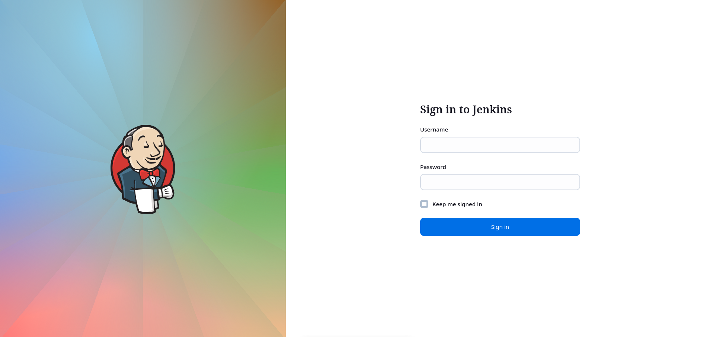
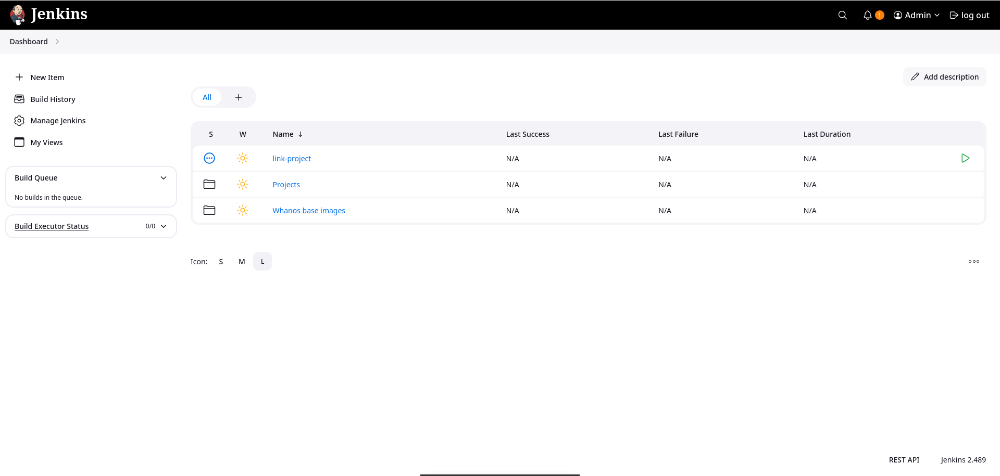
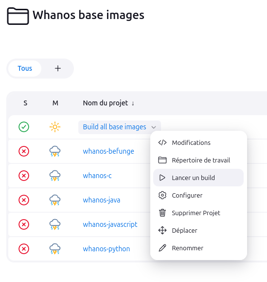
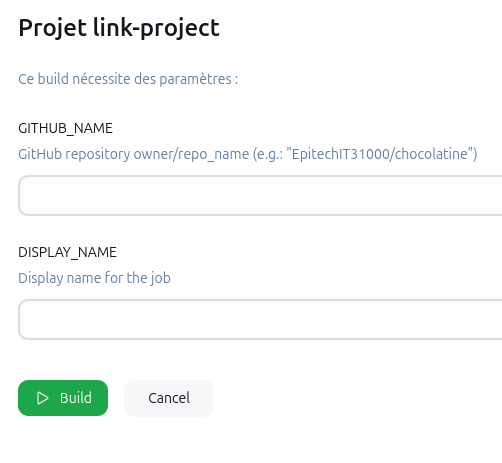

# Explanation Guide

Checkout different documentations :
- [Ansible](/docs/ansible.md)
- [Docker](/docs/docker.md)
- [Jenkins](/docs/jenkins.md)
- [Kubernetes](/docs/kubernetes.md)


# Installation & Deployment

## Guide to setting up a Kubernetes cluster with Ansible

### Step 1: Install Ansible
Let's start by installing ansible on your machine.


```bash
sudo apt update
sudo apt install ansible -y
```

### Step 2: Start your 2 virtual machines

1. **Create two virtual machines:**
   - A master machine
   - A worker machine

2. **Configure them to enable SSH connection with an RSA private key.**
   - RSA private key generation (if you don't already have one) :

        ```bash
        ssh-keygen -t rsa -b 4096 -f id_rsa
        ```
   - Copying public keys on virtual machines :

        ```bash
        ssh-copy-id -i id_rsa.pub <machine_user>@<machine_ip>
        ```

### Step 3: Connection configuration for Ansible

Create the file all.yml in the group_vars folder.

Typical structure of the group_vars/all.yml file :

```yaml
master_ip: 127.0.0.1
worker_ip: 192.0.0.2
ansible_user_master: ubuntu
ansible_user_worker: ubuntu
private_key_path_master: ./id_rsa
private_key_path_worker: ./id_rsa
```

### Step 4: Launching ansible
Run from project root the following command:

```bash
ansible-playbook -i ansible/production ansible/playbook.yml
```

This command will install everything needed to create a Kubernetes cluster with :

   - A master node
   - A worker node

### Step 5: Check installation

1. **Connect to the master machine via SSH :**

    ```bash
    ssh -i <ssh_key_path> <machine_user>@<master_ip>
    ```

2. **Check the status of Kubernetes nodes:**

    ```bash
    kubectl get nodes
    ```

This guide is now complete, and you have successfully set up a kubernetes cluster.

## Guide to launch Jenkins jobs and deploy the project

### Step 1: Connection to Jenkins interface

1. **Get the Jenkins interface URL:**
   Always connected in the master machine.

   ```bash
   NODE_PORT="$(kubectl get -n deployment -o jsonpath="{.spec.ports[0].nodePort}" services jenkins)"
   NODE_IP="$(kubectl get nodes -n deployment -o jsonpath="{.items[0].status.addresses[0].address}")"
   echo "http://$NODE_IP:$NODE_PORT"
   ```

2. **Connection to Jenkins interface:**
   Now open your browser and enter the URL you've just got.

   

   ```bash
   kubectl exec --namespace deployment -it svc/jenkins -c jenkins -- /bin/cat /run/secrets/additional/chart-admin-password && echo
   ```

   With this command, you can now log in with the user `admin` and the password you've just got.

   

### Step 2: Build all base images

To build all languages images
- click on `Whanos base images` folder
- click on `Build all base images` job
- click on `Launch build` on the left of the screen



### Step 3: Link project

To link a project to Whanos
- click on `link-project` job
- click on `build with parameters` on the left of the screen
- specify the GitHub repository name and the project name displayed
- click on green `Build` button

It will check for changes in your repository



