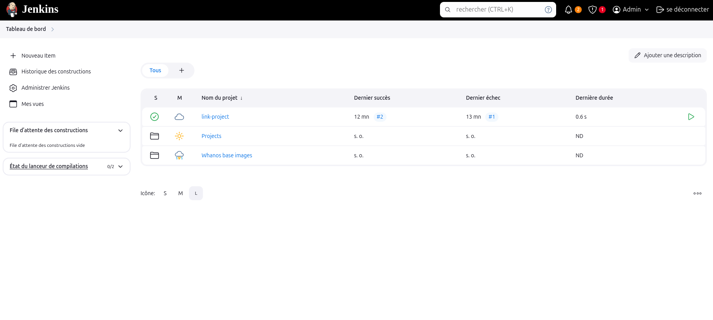
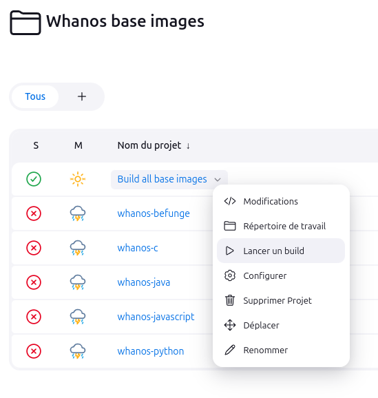

# Jenkins

## How to use Jenkins

Jenkins board allows us to launch asked commands

`Build all base images` to build all languages images
`link-project` to link a project to Whanos

### Build all base images

To build all languages images
- click on `Whanos base images` folder
- click on `Build all base images` job
- click on `Launch build` on the left of the screen

